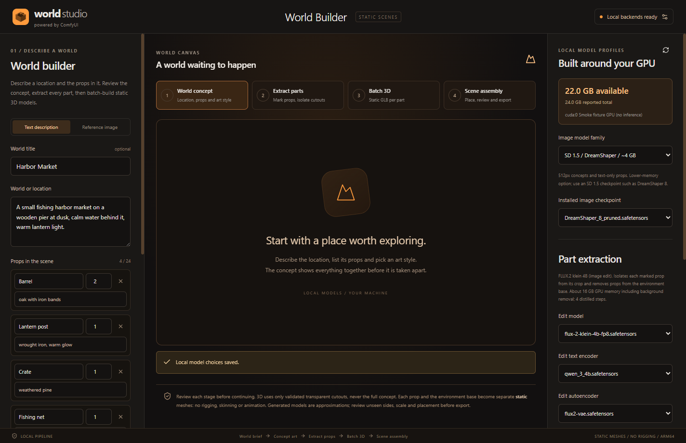
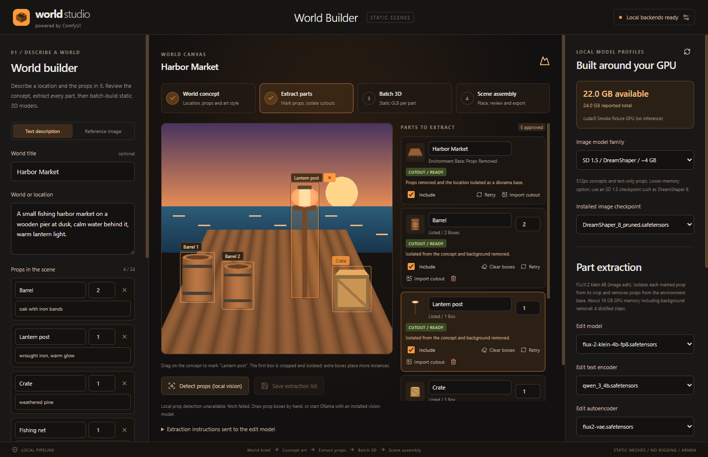
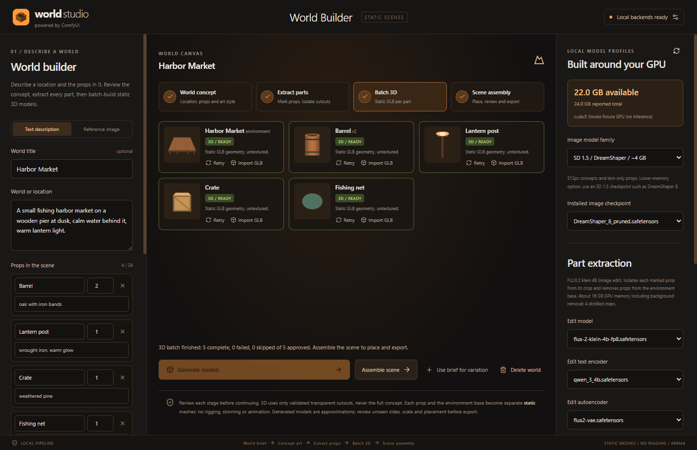
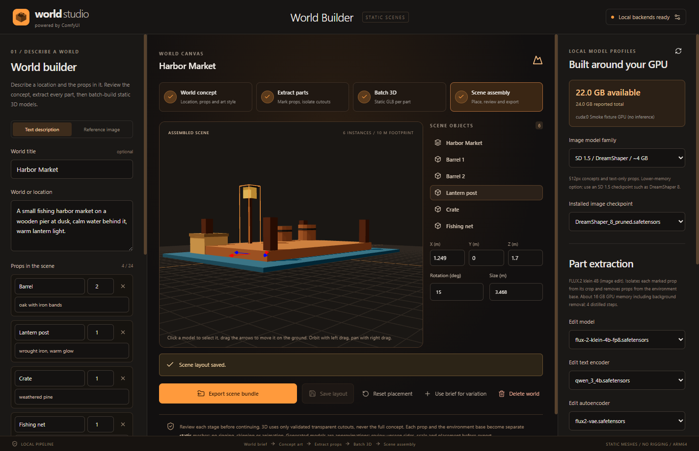

# World Studio

World Studio is a local desktop app for building 3D worlds and scenes for games. You describe a location, the props in it and an art style. The app then:

1. Generates a concept image of the location in that style.
2. Extracts every prop and an environment base, with the props removed, as transparent cutouts.
3. Batch-builds one **static** GLB model per part.
4. Lets you assemble the parts into a scene and export it.

It follows the UX and design rules of [Character Studio](https://github.com/rwrife/CharacterStudio) with an orange accent. Every model is static, so there is no rigging, skinning or animation.

All inference runs on your own machine. World Studio drives a local, loopback-only [ComfyUI](https://github.com/comfyanonymous/ComfyUI) and, optionally, a local [Ollama](https://ollama.com) vision model for prop detection. Generated meshes are approximations, not finished game assets.

## Features at a glance

- **World brief.** Enter a title, a location description, up to 24 props (each with a name, an optional description and a quantity), and an art style. You can add an optional reference image, seed and steps.
- **Concept art.** Generates a scene concept with SD 1.5 (DreamShaper 8, 512 px) or SDXL (1024 px). You can also import your own concept and skip this step.
- **Prop extraction.**
  - Mark each prop on the concept by dragging boxes. You can also run optional local detection with Ollama vision, which merges its results with your prop list.
  - The first box of each prop is cropped and isolated with FLUX.2 klein 4B image editing, then cut out with BiRefNet. Extra boxes place more instances.
  - Props you listed but didn't box get a text-generated reference in the same art style.
  - The environment base is the concept with the props removed.
- **Batch 3D.** Builds GLBs one after another for the environment and each approved part, using Hunyuan3D 2mini or Hunyuan3D 2 (geometry) or TRELLIS.2 (textured).
  - Each item shows its own progress, retry and GLB import.
  - Cancel stops only the running prompt.
  - Failures are reported per item and are never shown as completed.
- **Scene assembly.** A Three.js viewport places the environment and every instance approximately where its 2D box was. You can edit position, rotation and size, then save the layout.
- **Export.** Writes one folder per world containing:
  - the assembled `scene.glb`;
  - each part under `models/`;
  - the concept and cutouts under `references/`;
  - a `world.json` manifest with transforms, prompts, seeds and model choices.
- **Local model profiles.** The app checks GPU memory before each job. **Download required models** fetches pinned, hash-verified weights into your ComfyUI folders.
- **Persistent worlds.** Each world is stored as a validated manifest. One shared job slot means one GPU job runs at a time.

## Screenshots

> All captures come from `npm run smoke` against a **fixture ComfyUI**. That backend returns procedural images and box meshes and runs no model inference. The captures show the real UI and flow, not the quality of generated output.

### World brief and concept



### Prop extraction



### Batch 3D



### Scene assembly



## Launch

You need Windows, Node.js 20 or later, and a local ComfyUI install. ARM64 and x64 both work, and the app was developed on Windows ARM64. From the repository root in PowerShell:

```powershell
npm install
npm run dev        # development app with hot reload
npm run build      # typecheck + production build into out/
npm start          # open the production build
```

Other commands:

```powershell
npm test           # node --test unit tests (shared logic, workflows, validation, jobs)
npm run typecheck  # tsc --noEmit
npm run smoke      # build first; Playwright Electron smoke against a fixture ComfyUI
npm run smoke -- --live   # same flow against your configured ComfyUI (real inference)
npm run icon       # regenerate src/renderer/public/icon.png (the window and app icon)
```

World data lives in `%APPDATA%\WorldStudio`. Set `STUDIO_DATA_DIR` to use a different folder, for example for tests or smoke runs.

## World workflow

1. **World brief.** Describe the location and list the props. Choose **Text description**, or **Reference image** to guide the concept with an image of your own. Then click **Create world concept**. Review the concept and click **Use concept & extract parts**. To try a different concept, click **Use brief for variation**, which starts a new world from the same brief.
2. **Extract parts.** Select a prop row and drag a box on the concept for each visible instance.
   - **Detect props (local vision)** asks a local Ollama vision model for boxes. You can still edit them afterwards.
   - **Extract N parts** isolates each prop and builds the environment base.
   - Review each cutout. You can **Retry**, **Import cutout** or untick **Include**.
3. **Batch 3D.** Click **Generate models**. Items run in sequence. Retry a failed item, or import your own GLB for any item.
4. **Scene assembly.** Click a model, or pick it from **Scene objects**, to select it. Drag the arrows to move it on the ground, or type position, rotation and size. Click **Save layout**, then **Export scene bundle**.

3D generation only ever uses validated transparent cutouts, never the full concept. Each cutout must have a mostly transparent background and an object kept off the edges. Each generated or imported GLB is validated before it is accepted.

### Start from external inputs

You can import a concept image to skip concept generation, a cutout for any part, or a GLB for any part. Imports are validated the same way as generated outputs. Image imports are limited to 20 MB and GLBs to 500 MB.

### Offline models and memory profiles

The right panel, **Local model profiles**, shows the GPU memory ComfyUI reports and lets you pick installed weights for each stage.

| Stage | Model | Approx. free GPU memory |
| --- | --- | --- |
| Concept and text-only props | SD 1.5 (DreamShaper 8), 512 px | ~4 GB |
| Concept and text-only props | SDXL base 1.0, 1024 px | ~8 GB |
| Prop isolation and environment base | FLUX.2 klein 4B fp8 + Qwen 3 4B + FLUX.2 VAE, with BiRefNet | ~16 GB |
| 3D geometry | Hunyuan3D 2mini | ~6 GB |
| 3D geometry | Hunyuan3D 2 | ~10 GB |
| Textured 3D | TRELLIS.2 + DINOv3 + TRELLIS.2 shape and texture VAEs | ~24 GB |

A job that would exceed the free memory is refused before it is submitted.

When weights are missing, **Download required models** offers these packages:
- BiRefNet
- the FLUX.2 klein editing set
- DreamShaper 8 or SDXL
- Hunyuan3D 2 (standard)
- TRELLIS.2

Each file is pinned to a Hugging Face revision and verified by SHA-256 after download. Downloads only start after you approve them. Matching files are reused, and other existing files are never overwritten. The Hunyuan3D 2mini checkpoint isn't downloaded automatically; install it in ComfyUI yourself, or use the standard profile. Review each model's license (shown in the download prompt) before use.

ComfyUI must provide the native nodes each workflow uses, such as the Hunyuan3Dv2 and Trellis2 nodes and background removal. Before submitting, World Studio checks `object_info` and reports any missing node types instead of failing silently.

### Local prop detection (optional)

Detection uses Ollama at `http://127.0.0.1:11434` only. It lists your installed models and requires one with the `vision` capability. Models that report remote inference are rejected. If Ollama isn't running, the app says so, and you can draw boxes by hand.

## Backend and limitations

- **Real inference hasn't been verified in this repository's validation.** Unit tests, the build and the Electron smoke all pass, but the smoke uses a procedural fixture ComfyUI. Run `npm run smoke -- --live` with your models installed to exercise the real pipeline.
- Placement is approximate. Boxes are mapped to the ground plane from the 2D concept, and each model is scaled from its box. Expect to adjust position, rotation and size.
- Single-view image-to-3D can't see hidden sides. Large environments come out as a single diorama-style mesh, not a navigable level.
- Hunyuan3D outputs are untextured geometry. TRELLIS.2 adds textures but needs much more GPU memory.
- Models are static meshes only. There is no rigging, skinning, LOD generation or collision geometry.
- ComfyUI must listen on loopback. The default is `http://127.0.0.1:8189`, with ComfyUI under `%LOCALAPPDATA%\ComfyUI`, and both can be changed in Settings. Non-loopback URLs are rejected.

## Data and reproducibility

Each world records:
- its brief, seeds and steps;
- the selected models;
- the extraction instructions sent to the edit model;
- every item's box, status and output.

**Use brief for variation** starts a new world from the same brief. Exported `world.json` manifests include this metadata so a scene can be regenerated or audited later.

## Security

- The renderer runs with context isolation and sandboxing, behind a narrow preload bridge.
- Every IPC payload, persisted manifest and imported file is validated with zod and format checks.
- Network access is limited to:
  - the loopback ComfyUI and Ollama endpoints;
  - pinned Hugging Face model downloads that you approve.
- No world assets, prompts or credentials are uploaded.
